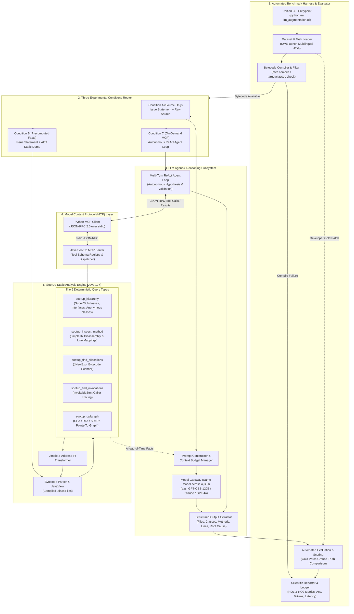

# Automated LLM-Augmented Java Program Analysis & Fault Localization Framework 

## 1. Executive Summary & Academic Alignment

This plan establishes the architecture and implementation specifications for the Master Thesis:  
**"LLM-Augmented Java Program Analysis via SootUp Integration"**.

The goal is to answer the two core research questions validated in the thesis proposal defense:
* **RQ1 (Effectiveness):** *Does augmenting an LLM agent with static analysis facts lead to better outcomes on Java program analysis tasks compared to an LLM agent operating on source code alone?*
* **RQ2 (Cost-Benefit & Feasibility):** *Does the gain in performance justify the cost of maintaining LLM agents and running a dedicated SootUp server (in terms of token consumption, tool call overhead, and execution latency)?*

The system provides an **autonomous, zero-human-intervention pipeline** configurable from the command line:
1. Loads benchmark defect instances from **SWE-bench Multilingual (Java)** across enterprise projects (`google/gson`, `apache/druid`, `apache/lucene`, `projectlombok/lombok`, `javaparser/javaparser`, `reactivex/rxjava`).
2. Verifies bytecode compilation (`mvn compile`) or reports uncompilable instances according to the defense methodology.
3. Executes fault localization across three experimental conditions (**Condition A: Source only**, **Condition B: Precomputed facts**, **Condition C: On-demand MCP tools**).
4. Evaluates localization precision and downstream patch resolution against developer Gold Patches automatically.

---

## 2. System Architecture: LLM Agent vs. SootUp Analyzer

The system establishes a clean separation of concerns:
- **LLM Agent Subsystem (Cognitive Reasoning):** Formulates hypotheses, reasons over bug reports and source code, decides when to request structural facts, and synthesizes root-cause diagnoses.
- **SootUp Static Analysis Subsystem (Deterministic Truth):** Ingests compiled bytecode into Jimple 3-address IR and answers low-level structural queries with mathematical precision.
- **Model Context Protocol (MCP) Bridge:** Standardized JSON-RPC 2.0 communication over standard I/O connecting the Python agent to the Java SootUp process.



---

## 3. The 3 Experimental Conditions: Detailed Behavior & Trade-offs

| Condition | Execution Workflow | Advantage (Potential Reward) | Scientific Risk / Failure Mode |
| :--- | :--- | :--- | :--- |
| **A: Source Only (Baseline)** | The LLM receives the bug report description and source code files with zero external static facts. Single-turn prompt or standard search. | Token-efficient; clean experimental baseline. | Suffers from **token-level heuristic tunnel vision**; misses cross-class data flows and dynamic virtual dispatches. |
| **B: Precomputed Facts (Passive Injection)** | SootUp queries run beforehand. Results (hierarchies, Jimple methods, allocation sites) are serialized and injected directly into prompt context. | Structural facts available immediately without multi-turn latency. | **Confirmation Bias & Prompt Noise**: Dense facts arrive whether needed or not; LLM frequently overrides static evidence with model priors. |
| **C: On-Demand MCP Tools (Active Agent)** | The LLM operates in an autonomous ReAct agent loop equipped with live SootUp tools exposed via MCP. Queries bytecode dynamically during reasoning. | **Selective querying**: Facts arrive on-demand to test and pivot specific hypotheses with 100% ground-truth parity. | **Cost & Latency**: Multi-turn tool invocation overhead; potential risk of agent ignoring tools or querying irrelevant targets. |

---

## 4. The 5 Deterministic SootUp Bytecode Primitives

The backend implements the 5 query types validated during preliminary thesis experiments:

1. **`sootup_hierarchy(target_class)`**
   * *Question answered:* Which classes extend or implement this class?
   * *Output:* Superclasses, subclasses, and implemented interfaces (including anonymous compiler-generated subclasses e.g. `Gson$1`, `Gson$2`).
2. **`sootup_inspect_method(target_class, method_name)`**
   * *Question answered:* What does this method do?
   * *Output:* Disassembled method body in Jimple 3-address IR, source line mapping, declaring class, and outer enclosing class.
3. **`sootup_find_allocations(target_class, [scope_class])`**
   * *Question answered:* Where are objects of this class created?
   * *Output:* Methods and source line numbers instantiating `target_class` via `JNewExpr`. Pinpoints factory registration sites.
4. **`sootup_find_invocations(target_class, target_method, [scope_class])`**
   * *Question answered:* Who calls this method?
   * *Output:* Interprocedural call sites across modules without requiring whole-program call-graph computation.
5. **`sootup_callgraph(algorithm, entry_signature, direction)`**
   * *Question answered:* Which methods can be reached from an entry point?
   * *Output:* Reachable call paths using Class Hierarchy Analysis (CHA), Rapid Type Analysis (RTA), or SPARK points-to analysis.

---

## 5. Evaluation Protocol & Scientific Metrics (RQ1 & RQ2)

The framework evaluates predictions against the ground-truth developer Gold Patch without human intervention:

### 5.1 Primary Metrics (RQ1 - Accuracy & Localization Quality)
* **File-Level Localization:**
  * File Recall: Percentage of gold patch files correctly identified.
  * File Precision & F1-score: Proportion of predicted files that were actually modified.
* **Method-Level Hit Rate:**
  * Exact match with methods modified in the developer fix.
* **Line-Level Proximity:**
  * Proximity distance (lines) between predicted fault locations and actual diff hunks.
* **Downstream Patch Resolution %:**
  * As specified in the proposal defense (Slide 18 & 31): Measure whether the localized context enables patch generation passing the task harness.

### 5.2 Efficiency & Cost Metrics (RQ2 - Justifying Agent & Server Costs)
* **Total Token Cost:** Prompt tokens, completion tokens, and dollar cost per task.
* **Tool Call Volume & Precision (Condition C):** Total tool invocations, distribution across the 5 primitives, and tool call hit-rate.
* **Latency:** Execution duration per task (seconds).
* **Compilation Feasibility:** Automatic reporting of tasks compiled vs. skipped due to compilation errors.

---

## 6. Repository Layout (`llm-augmentation`)

```text
llm-augmentation/
├── .agents/
│   └── plans/
│       └── 01_automated_localization_framework_plan.md   # This document
├── pyproject.toml                                        # Python packaging & dependencies
├── README.md                                             # Setup, architecture & CLI usage
├── config.yaml                                           # Global defaults (models, timeouts, paths)
│
├── sootup_engine/                                        # Java 17+ Maven Project (SootUp 3.x)
│   ├── pom.xml                                           # SootUp 3.0.2-SNAPSHOT dependencies
│   └── src/main/java/org/sootup/
│       ├── SootUpAnalyzer.java                           # Core CLI & static primitives
│       ├── SootUpMcpServer.java                          # JSON-RPC 2.0 MCP server over stdio
│       └── primitives/                                   # Primitive handlers
│           ├── HierarchyHandler.java
│           ├── MethodInspector.java
│           ├── AllocationScanner.java
│           ├── InvocationTracer.java
│           └── CallGraphBuilder.java
│
├── llm_augmentation/                                     # Core Python Framework
│   ├── __init__.py
│   ├── cli.py                                            # Unified CLI entrypoint
│   │
│   ├── benchmark/                                        # Benchmark & Dataset Management
│   │   ├── __init__.py
│   │   ├── task_loader.py                                # Ingests SWE-Bench Java JSON definitions
│   │   ├── repo_manager.py                               # Git checkout @ base_commit & compile checker
│   │   └── task.py                                       # Task dataclass
│   │
│   ├── mcp/                                              # Model Context Protocol Bridge
│   │   ├── __init__.py
│   │   ├── client.py                                     # MCP Subprocess stdio client
│   │   └── tool_schemas.py                               # Tool definitions for LLM function calling
│   │
│   ├── agents/                                           # Condition Runners
│   │   ├── __init__.py
│   │   ├── base_agent.py                                 # Abstract Agent interface
│   │   ├── condition_a_agent.py                          # Condition A (Source only)
│   │   ├── condition_b_agent.py                          # Condition B (Precomputed static injection)
│   │   ├── condition_c_agent.py                          # Condition C (On-demand MCP tool loop)
│   │   └── llm_gateway.py                                # LLM provider abstraction (OpenAI, Anthropic, OSS)
│   │
│   ├── evaluation/                                       # Automated Evaluation & Ground Truth
│   │   ├── __init__.py
│   │   ├── patch_parser.py                               # Parses developer Gold Patches (.patch diffs)
│   │   ├── metrics.py                                    # Computes File/Method Recall, Precision, Line Proximity
│   │   └── evaluator.py                                  # Unattended evaluation engine
│   │
│   └── reporting/                                        # Scientific Output & Logging
│       ├── __init__.py
│       ├── json_logger.py                                # Detailed per-task trace logs
│       └── markdown_reporter.py                          # Automated summary tables & thesis reports
│
├── datasets/                                             # 43 SWE-Bench Java tasks
│   ├── druid_tasks.json
│   ├── gson_tasks.json
│   ├── javaparser_tasks.json
│   ├── lombok_tasks.json
│   ├── lucene_tasks.json
│   └── rxjava_tasks.json
│
└── tests/                                                # Test suite
    ├── test_patch_parser.py
    ├── test_mcp_client.py
    ├── test_evaluator.py
    └── test_cli_runner.py
```

---

## 7. Command-Line Interface (CLI) Specification

```bash
# 1. Single Task Execution (configurable for Condition A, B, or C)
python -m llm_augmentation.cli run \
  --condition [A|B|C] \
  --task <task_id> \
  --model <model_name> \
  --output-dir results/

# 2. Automated Benchmark Execution (Unattended Batch Run)
python -m llm_augmentation.cli benchmark \
  --dataset datasets/gson_tasks.json \
  --condition C \
  --model gpt-oss-120b \
  --output-dir results/benchmark_c/ \
  --timeout-per-task 300

# 3. Direct Three-Condition Comparison Matrix (A vs B vs C)
python -m llm_augmentation.cli compare \
  --task google__gson-2158 \
  --model gpt-oss-120b \
  --output-dir results/comparison_gson_2158/
```

---

## 8. Implementation Steps & Verification Plan

1. **Step 1: Java SootUp Engine & MCP Server Setup**
   * Port tested `SootUpAnalyzer.java` into `sootup_engine/`.
   * Implement `SootUpMcpServer.java` handling standard JSON-RPC 2.0 requests over `stdio`.
   * Verify via unit tests that all 5 primitives respond with valid JSON.
2. **Step 2: Python MCP Client & Benchmark Ingestion**
   * Implement `McpClient` in Python that spawns the Java process and dispatches tool calls.
   * Ingest SWE-Bench Java datasets and verify git checkout & compile checks.
3. **Step 3: Condition Agents (A, B, C) Implementation**
   * Implement Condition A baseline agent.
   * Implement Condition B static extractor and prompt assembler.
   * Implement Condition C ReAct tool-calling loop.
4. **Step 4: Ground Truth Parser & Automated Evaluator**
   * Build `patch_parser.py` to extract modified files, methods, and line hunks from Gold Patches.
   * Build `evaluator.py` to compute metrics (Precision, Recall, F1, Proximity, Costs) with zero human intervention.
5. **Step 5: End-to-End Verification against Known Case Studies**
   * Run the CLI on `google__gson-2158` across Conditions A, B, and C.
   * Verify reproduction of the proposal defence results (Condition A misses `Gson.java`, Condition B/C successfully finds `Gson.doubleAdapter()`).
   * Validate that comprehensive JSON logs and Markdown reports are produced unattended.
