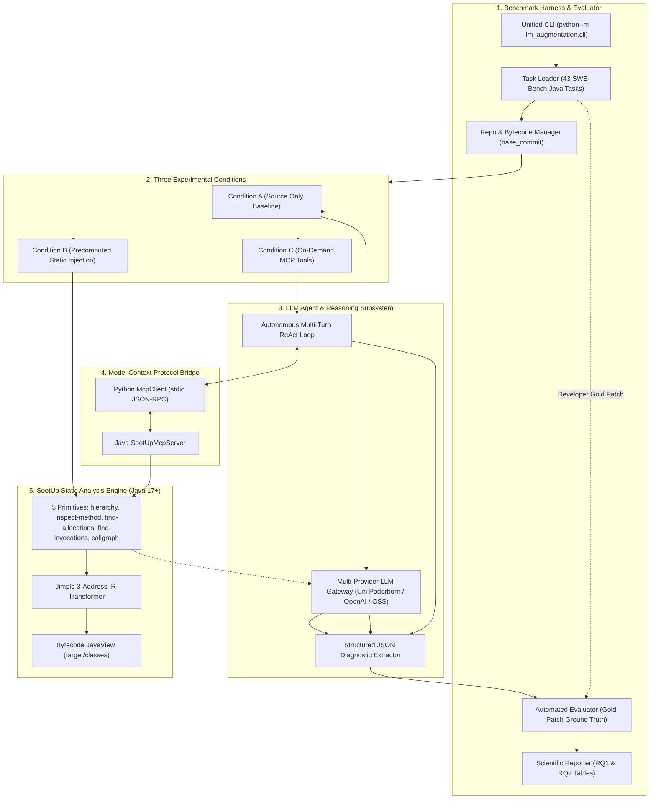

# LLM-Augmented Java Program Analysis & Fault Localization via SootUp

[](https://openjdk.org/)
[](https://maven.apache.org/)
[](https://www.python.org/)
[](https://github.com/soot-oss/SootUp)
[](https://modelcontextprotocol.io/)

An automated empirical research framework for **LLM-Augmented Java Program Analysis and Fault Localization**, investigating whether augmenting Large Language Models with whole-program static analysis facts (via **SootUp 3.x** and the **Model Context Protocol**) overcomes non-local semantic reasoning blindspots across complex Java defects.

Developed at the **Heinz Nixdorf Institute (SSE), University of Paderborn** and **Fraunhofer IEM** (Chair: Prof. Dr. Eric Bodden).

---

## 1. System Architecture

The framework cleanly separates the cognitive reasoning agent from the formal static analysis engine via standard JSON-RPC 2.0 over `stdio`:



---

## 2. The Three Experimental Conditions

| Condition | Workflow | Primary Focus |
| :--- | :--- | :--- |
| **Condition A (Baseline)** | Bug description + source code files only. Zero external static facts. | Measures baseline token-level heuristic reasoning and search tunnel vision. |
| **Condition B (Precomputed)** | SootUp static facts are extracted ahead of time and injected into the prompt. | Evaluates whether dense static context triggers LLM Confirmation Bias. |
| **Condition C (On-Demand MCP)** | Autonomous agent interacting dynamically with live SootUp MCP tools in a ReAct loop. | Evaluates selective on-demand querying to resolve dynamic dispatch and non-local bugs. |

---

## 3. The 5 Deterministic Static Analysis Primitives

1. **`sootup_hierarchy(target_class)`**: Retrieves superclasses, subclasses (including compiler-generated anonymous inner classes like `Gson$1`), and implemented interfaces.
2. **`sootup_inspect_method(target_class, target_method)`**: Disassembles method bodies into Jimple 3-address IR with source line numbers, declaring classes, and outer enclosing classes.
3. **`sootup_find_allocations(target_class, [scope_class])`**: Scans Jimple bodies for `JNewExpr` to pinpoint factory creation sites.
4. **`sootup_find_invocations(target_class, target_method, [scope_class])`**: Traces cross-module call sites without full call-graph computation.
5. **`sootup_callgraph(algorithm, entry_class, entry_method, return_type)`**: Builds interprocedural call graphs using CHA, RTA, or SPARK.

---

## 4. Benchmark Dataset

The framework ingests **43 real-world defect tasks** from the **SWE-Bench Multilingual (Java)** dataset across 6 major enterprise codebases:
* `google/gson` (9 tasks)
* `apache/druid` (5 tasks)
* `apache/lucene` (9 tasks)
* `projectlombok/lombok` (17 tasks)
* `javaparser/javaparser` (2 tasks)
* `reactivex/rxjava` (1 task)

---

## 5. Quickstart & CLI Reference

### 5.1 Build the SootUp Engine
```bash
cd sootup_engine
mvn clean compile
```

### 5.2 Run Single Task Localization
```bash
# Run Condition A (Source only)
python -m llm_augmentation.cli run -c A -t google__gson-2158

# Run Condition B (Precomputed static injection)
python -m llm_augmentation.cli run -c B -t google__gson-2158

# Run Condition C (On-Demand MCP ReAct Agent)
python -m llm_augmentation.cli run -c C -t google__gson-2158
```

### 5.3 Batch Benchmark Execution (Zero Human Intervention)
```bash
python -m llm_augmentation.cli benchmark \
  -d datasets/gson_tasks.json \
  -c C \
  -o results/gson_eval_c/ \
  --timeout-per-task 300
```

### 5.4 Compare All 3 Conditions
```bash
python -m llm_augmentation.cli compare -t google__gson-2158 -o results/comparison/
```

### 5.5 Query SootUp Directly via CLI
```bash
python -m llm_augmentation.cli tools hierarchy \
  --target-class com.google.gson.TypeAdapter \
  --target-dir sootup_engine/target/classes
```

---

## 6. Automated Evaluation & Metrics (RQ1 & RQ2)

* **RQ1 (Localization Accuracy):** File-Level Recall, Precision, F1-Score, Exact Match, Method Hit Rate, Line Proximity, Downstream Patch Resolution %.
* **RQ2 (Cost & Efficiency):** Tool Calls Count, Token Consumption (Prompt + Completion), Execution Latency (seconds), Compilation Feasibility Status.

Reports are automatically generated in both machine-readable JSON (`*_eval.json`) and publication-ready Markdown tables (`*_report.md`).
