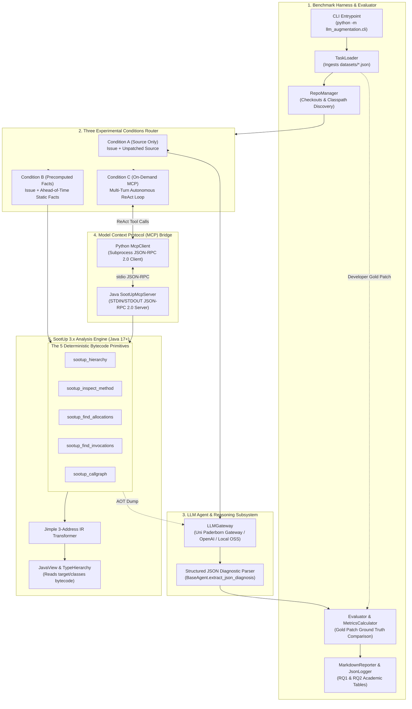
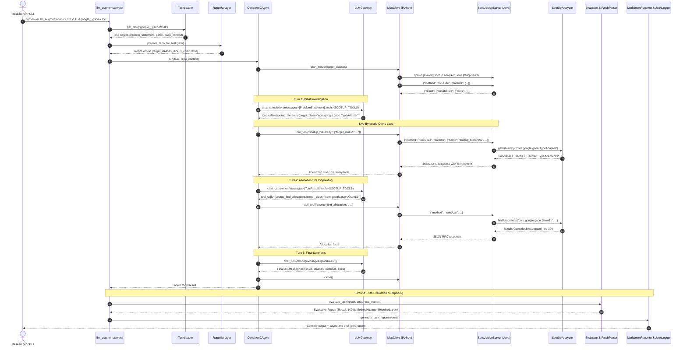

# Project Architecture & End-to-End Execution Flow

This document details the system architecture and runtime execution lifecycle of the **LLM-Augmented Java Program Analysis** framework.

---

## 1. Architectural Overview

The framework decouples cognitive reasoning from formal program analysis:
- **LLM Agent Subsystem (Python):** Handles natural-language comprehension of bug reports, hypothesis generation, multi-turn tool interaction, and diagnostic synthesis.
- **SootUp Static Analysis Subsystem (Java 17+):** Reads compiled bytecode (`.class` files), lifts bytecode into Jimple 3-address Intermediate Representation (IR), and executes deterministic structural queries.
- **Model Context Protocol (MCP) Bridge:** Standardized JSON-RPC 2.0 communication over standard I/O (`stdio`), enabling the Python agent to invoke Java SootUp tools on-demand with minimal overhead.

---

## 2. Core Subsystems & Responsibilities

### 2.1 Benchmark Harness & Dataset Manager
- **[`TaskLoader`](../llm_augmentation/benchmark/task_loader.py):** Loads and indexes the 43 SWE-Bench Multilingual (Java) defect tasks stored in `datasets/`.
- **[`RepoManager`](../llm_augmentation/benchmark/repo_manager.py):** Locates target open-source repositories (`google/gson`, `apache/druid`, etc.), optionally checks out `base_commit`, identifies multi-module `target/classes` bytecode directories, and validates whether the target codebase compiles.
- **[`PatchParser`](../llm_augmentation/evaluation/patch_parser.py):** Analyzes the developer's Gold Patch (`.patch` unified diff) to establish ground-truth modified files, classes, methods, hunks, and exact lines touched.

### 2.2 Experimental Condition Router
The CLI routes execution to one of three experimental conditions defined by the thesis research design:
1. **Condition A (`ConditionAAgent`):** Baseline source-only prompt. Measures the model's token-level reasoning without static analysis assistance.
2. **Condition B (`ConditionBAgent`):** Passive static injection. Extracts structural facts ahead-of-time (AOT) and embeds them directly into the prompt context to observe whether the model suffers from **Confirmation Bias**.
3. **Condition C (`ConditionCAgent`):** Active on-demand tool calling. Launches a multi-turn ReAct loop where the model queries live SootUp static analysis tools via MCP.

### 2.3 LLM Gateway & Provider Layer
- **[`LLMGateway`](../llm_augmentation/agents/llm_gateway.py):** Connects to OpenAI-compatible endpoints, auto-detecting environment credentials for the **University of Paderborn AI Gateway** (`https://ai-gateway.uni-paderborn.de`), OpenAI, Anthropic, or local inference engines (vLLM / Ollama).
- Formats tool schemas using the standard OpenAI function calling format.

### 2.4 Model Context Protocol (MCP) Bridge
- **[`McpClient`](../llm_augmentation/mcp/client.py):** Spawns the Java MCP server as a subprocess using cached dependency classpaths (`classpath.txt`), executing the `initialize` handshake and relaying tool calls.
- **[`SootUpMcpServer`](../sootup_engine/src/main/java/org/sootup/analyzer/SootUpMcpServer.java):** Listens on standard input for JSON-RPC 2.0 messages, routes requests to `SootUpAnalyzer`, caches `JavaView` instances by target directory, and formats responses back to standard output.

### 2.5 SootUp 3.x Static Analysis Engine
- **[`SootUpAnalyzer`](../sootup_engine/src/main/java/org/sootup/analyzer/SootUpAnalyzer.java):** Interacts directly with `sootup.core`, `sootup.java.bytecode`, and `sootup.callgraph`.
- Translates `.class` files into Jimple 3-address statements with source line mapping.
- Prunes bytecode searches to application classes (`isApplicationClass()`), avoiding whole-JDK traversal and achieving sub-second query latency.

---

## 3. End-to-End Execution Sequence

The following sequence diagram illustrates an unattended benchmark run under **Condition C** (Active MCP Tool Calling):

---

## 4. Cognitive Agent vs. Deterministic Static Engine

A core contribution of this thesis is clearly separating what the LLM does from what SootUp does:

| Capability | LLM Agent | SootUp Static Analysis Engine |
| :--- | :--- | :--- |
| **Input** | Bug issue descriptions, stack traces, source text, tool outputs. | Compiled Java bytecode (`.class` files in `target/classes`). |
| **Strengths** | Natural-language comprehension, intent recognition, hypothesis generation, synthesizing root causes. | Deterministic, whole-program mathematical ground truth (subclasses, call graphs, Jimple 3-address IR, allocations). |
| **Failure Modes** | Heuristic tunnel vision, syntactic confirmation bias, hallucinated paths. | Lacks context about user requirements or natural-language bug descriptions. |
| **Combined Synergies** | Guides *what* structural questions to ask based on bug symptoms. | Authoritatively provides *answers*, preventing LLM hallucination and overcoming confirmation bias. |

---

## Related Documents
- [Installation & Troubleshooting Guide](02_installation_and_troubleshooting.md)
- [CLI Reference Guide](03_cli_reference.md)
- [SootUp Engine & MCP Bridge Guide](07_sootup_and_mcp_bridge.md)
- [Evaluation & Metrics Guide](06_evaluation_and_metrics.md)
