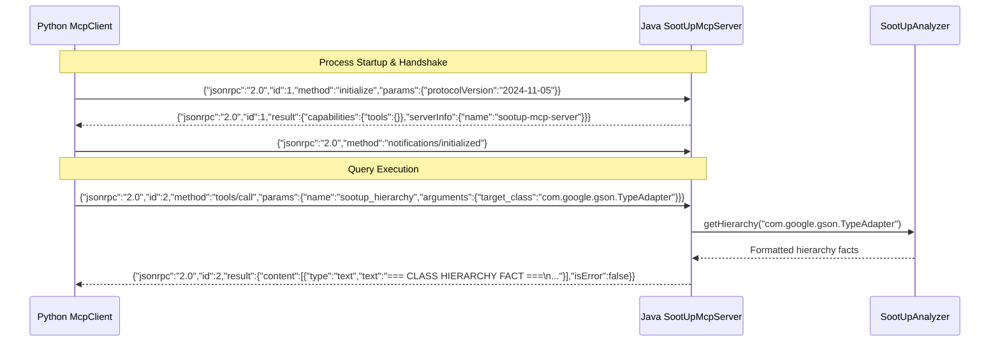

# SootUp Static Analysis Tools & MCP Communication Flow

This document details the internal design of the **SootUp 3.x static analysis engine**, the five deterministic bytecode primitives, and the **Model Context Protocol (MCP)** communication bridge.

---

## 1. Why Static Analysis on Bytecode via Jimple IR?

State-of-the-art LLMs process source code as linear token sequences. This approach encounters blindspots in modern Java software:
* **Anonymous Inner Classes:** High-level Java source code hides compiler artifacts. In Google Gson, specialized type adapters are generated as anonymous inner classes (`Gson$1`, `Gson$2`) inside factory methods.
* **Polymorphic Invocations:** Callsites invoke interfaces (e.g. `TypeAdapter.write()`), but the executed logic resides in decoupled subclasses.
* **Jimple 3-Address Representation:** SootUp lifts JVM bytecode into **Jimple**, a 3-address Intermediate Representation (IR). Jimple normalizes complex expressions into simple statements, enabling precise identification of object allocations (`new Target`), virtual dispatches (`virtualinvoke`), and source line positions.

---

## 2. The 5 Deterministic Bytecode Primitives

Implemented in [`SootUpAnalyzer.java`](../sootup_engine/src/main/java/org/sootup/analyzer/SootUpAnalyzer.java):

### Primitive 1: `sootup_hierarchy`
* **Purpose:** Uncovers the inheritance tree and all registered implementations, including compiler-generated inner classes.
* **Engine API:** `sootup.core.typehierarchy.ViewTypeHierarchy`
* **Output:** Transitive superclasses, direct/indirect subclasses, and implemented interfaces.
* **Example Output:**
  ```text
  === CLASS HIERARCHY FACT ===
  Target: com.google.gson.TypeAdapter

  Superclasses:
   - java.lang.Object

  Subclasses:
   - com.google.gson.Gson$1
   - com.google.gson.Gson$2
   - com.google.gson.internal.bind.TypeAdapters$1
   - com.google.gson.internal.bind.TypeAdapters$2
  ```

### Primitive 2: `sootup_inspect_method`
* **Purpose:** Disassembles a method into Jimple IR, printing source line mappings, declaring classes, and outer enclosing classes.
* **Engine API:** `JavaSootClass.getMethodsByName()`, `SootMethod.getBody().getStmts()`
* **Output:** Jimple instructions with source line prefixes and outer enclosing class links.
* **Example Output:**
  ```text
  === METHOD INSPECTION FACT ===
  Signature: <com.google.gson.Gson$1: void write(com.google.gson.stream.JsonWriter, java.lang.Number)>
  Declaring Class: com.google.gson.Gson$1
  Outer Class: com.google.gson.Gson
  Source File: com/google/gson/Gson.java

  Jimple Body:
  [Line 394] this := @this: com.google.gson.Gson$1
  [Line 394] out := @parameter0: com.google.gson.stream.JsonWriter
  [Line 394] value := @parameter1: java.lang.Number
  [Line 395] if value != null goto [Line 399]
  [Line 396] virtualinvoke out.<com.google.gson.stream.JsonWriter: com.google.gson.stream.JsonWriter nullValue()>()
  ```

### Primitive 3: `sootup_find_allocations`
* **Purpose:** Scans Jimple statements for `JNewExpr` to pinpoint where a target class is instantiated (`new TargetClass()`).
* **Engine API:** Searches `JAssignStmt` where `stmt.getRightOp() instanceof JNewExpr`.
* **Application Class Pruning:** Only scans application classes (`isApplicationClass()`), skipping tens of thousands of JDK runtime classes to execute in under 100ms.
* **Example Output:**
  ```text
  === ALLOCATION SITE FACT ===
  Target Class: com.google.gson.Gson$1
  Scope Class: com.google.gson.Gson

  Match Found:
   - Allocates: com.google.gson.Gson$1
   - Enclosing Method: <com.google.gson.Gson: com.google.gson.TypeAdapter doubleAdapter(boolean)>
   - Source Line: 394
   - Jimple Stmt: $stack2 = new com.google.gson.Gson$1
  ```

### Primitive 4: `sootup_find_invocations`
* **Purpose:** Finds all caller sites invoking a target method across modules without requiring whole-program call-graph computation.
* **Engine API:** Checks `stmt.isInvokableStmt()` and extracts `AbstractInvokeExpr.getMethodSignature()`.
* **Example Output:**
  ```text
  === INVOCATION SITE FACT ===
  Target Method: org.apache.druid.java.util.common.JodaUtils.condenseIntervals

  Match Found:
   - Invokes: <org.apache.druid.java.util.common.JodaUtils: java.util.List condenseIntervals(java.lang.Iterable)>
   - Enclosing Method: <org.apache.druid.query.spec.MultipleIntervalSegmentSpec: java.util.List getIntervals()>
   - Source Line: 88
  ```

### Primitive 5: `sootup_callgraph`
* **Purpose:** Constructs an interprocedural Call Graph starting from an entry point.
* **Supported Algorithms:**
  - `cha`: Class Hierarchy Analysis (fastest, coarse-grained).
  - `rta`: Rapid Type Analysis (filters calls by instantiated types).
  - `spark`: SPARK Points-To Analysis (`onFlyCallGraph=true`, highest precision).
* **Output:** Total reachable methods, outgoing calls (`callTargetsFrom`), and incoming calls (`callSourcesTo`).

---

## 3. Model Context Protocol (MCP) Bridge

The bridge communicates via standard JSON-RPC 2.0 messages over standard I/O (`stdin` / `stdout`).



### 3.1 JavaView Caching Architecture
Constructing a `JavaView` involves reading `.class` bytecode and building type hierarchies. To ensure sub-second query latency during multi-turn agent interactions:
```java
private static final Map<String, SootUpAnalyzer> analyzerCache = new ConcurrentHashMap<>();
```
* **First Query:** Loads `.class` files into `JavaView` (~1.5–3.0 seconds).
* **Subsequent Queries:** Reuses cached `JavaView` (<50 milliseconds).

---

## 4. MCP Tool Schemas for LLM Function Calling

Registered in [`SOOTUP_TOOLS`](../llm_augmentation/mcp/tool_schemas.py):

| Tool Name | Key Parameters | Schema Requirement |
| :--- | :--- | :--- |
| `sootup_hierarchy` | `target_class` (str), `target_dir` (opt) | `target_class` required |
| `sootup_inspect_method` | `target_class` (str), `target_method` (str), `target_dir` (opt) | `target_class`, `target_method` required |
| `sootup_find_allocations`| `target_class` (str), `scope_class` (opt), `target_dir` (opt) | `target_class` required |
| `sootup_find_invocations`| `target_class` (str), `target_method` (str), `scope_class` (opt) | `target_class`, `target_method` required |
| `sootup_callgraph` | `algorithm` (cha\|rta\|spark), `entry_class`, `entry_method`, `return_type` | `algorithm`, `entry_class`, `entry_method`, `return_type` required |

---

## Related Documents
- [Architecture & Execution Flow](01_architecture_and_flow.md)
- [CLI Reference Manual](03_cli_reference.md)
- [Running Experiments Manual](05_running_experiments.md)
- [Evaluation & Metrics Specification](06_evaluation_and_metrics.md)
