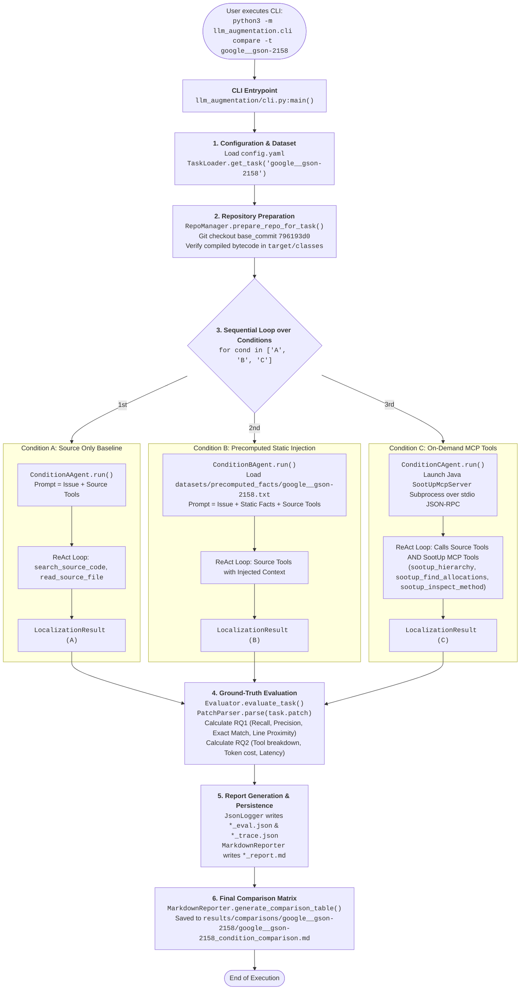
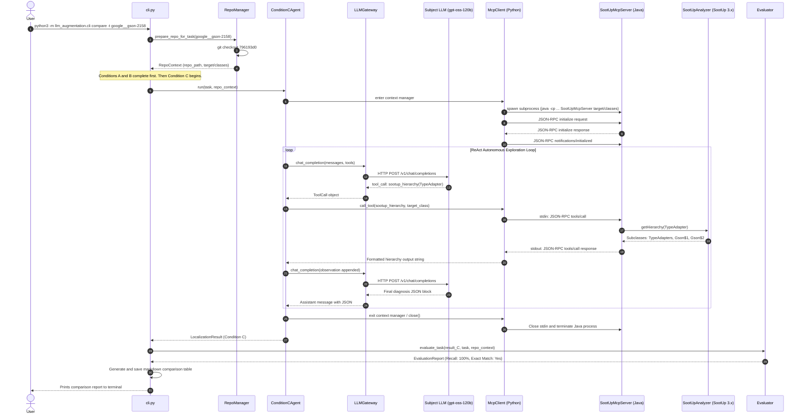
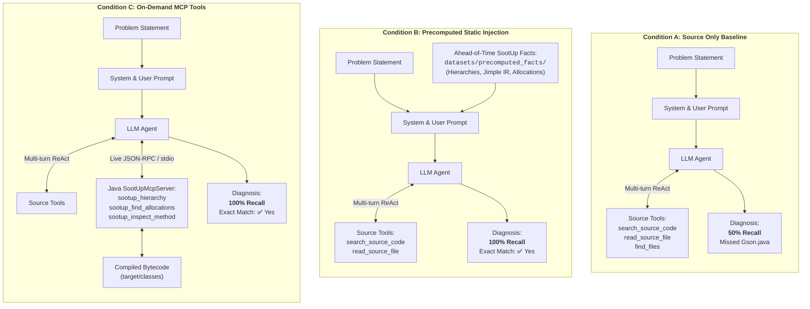

# End-to-End Execution Walkthrough: `cli compare`

This guide provides a comprehensive, step-by-step walkthrough of what happens under the hood when you execute the three-condition comparative evaluation command:

```bash
python3 -m llm_augmentation.cli compare -t google__gson-2158
```

The intended audience is anyone with general programming knowledge who wants to understand the exact runtime mechanics, internal architecture, commands executed, and data flows of this research framework without having to read through all source files first.

---

## 1. Core Technical Concepts & Glossary

To make this walkthrough accessible, key technical terms are defined below as they apply to this framework:

| Term | Meaning in this Project |
| :--- | :--- |
| **CLI (Command Line Interface)** | The terminal entrypoint ([`llm_augmentation/cli.py`](../llm_augmentation/cli.py)) that parses command-line arguments using Python's standard `argparse` module and dispatches to subcommands. |
| **Subprocess** | An independent operating system process launched from Python (using `subprocess.Popen` or `subprocess.run`). Used to invoke Git, Maven, javac, and the Java MCP server. |
| **Static Analysis** | Program analysis performed by inspecting compiled code structure without executing it. In this project, the **SootUp** Java analysis framework extracts class hierarchies, call graphs, Jimple intermediate representations, and object allocation sites from `.class` bytecode files. |
| **Bytecode** | The compiled binary form of Java code (`.class` files in Maven's `target/classes` directory) executed by the Java Virtual Machine (JVM). SootUp analyzes bytecode directly, allowing analysis of multi-module enterprise codebases. |
| **Jimple IR** | A 3-address, typed intermediate representation (IR) produced by SootUp. Unlike raw Java source or JVM bytecode, Jimple simplifies control flow into explicit statements with clear variable assignments and line-number anchors. |
| **MCP (Model Context Protocol)** | An open protocol created by Anthropic that standardizes how AI applications provide tools and context to Large Language Models. In this project, the MCP bridge exposes deterministic SootUp static analysis methods to the LLM via standard JSON-RPC over `stdio`. |
| **JSON-RPC 2.0** | A lightweight remote procedure call protocol encoded in JSON. The Python client sends single-line JSON requests to the standard input (`stdin`) of the Java process and reads single-line JSON responses from standard output (`stdout`). |
| **ReAct Loop** | A multi-turn conversational pattern combining **Rea**soning (the model outputs thoughts or requests tools) and **Act**ing (the harness executes the requested tool and returns the observation to the model) until the model outputs its final diagnosis. |
| **Ground Truth** | The reference defect information extracted from the original human developer's bug-fixing Git pull request commit (the "gold patch"). |
| **Fault Localization (FL)** | The research task of identifying the exact root-cause files, classes, methods, and line numbers where a bug exists, without generating or applying code patches. |

---

## 2. File Responsibility Index

The following table indexes all primary Python and Java source files involved in executing the `compare` command:

| File Path | Primary Class / Component | Core Responsibility |
| :--- | :--- | :--- |
| [`llm_augmentation/cli.py`](../llm_augmentation/cli.py) | `main()`, `handle_compare()` | Parses CLI arguments, loads configuration, coordinates repository preparation, executes conditions sequentially, and triggers reporting. |
| [`llm_augmentation/config.py`](../llm_augmentation/config.py) | `load_config()` | Reads `config.yaml` to retrieve model defaults, execution timeouts, max tool iterations, and relative engine paths. |
| [`llm_augmentation/benchmark/task_loader.py`](../llm_augmentation/benchmark/task_loader.py) | `TaskLoader` | Ingests benchmark tasks from `datasets/*.json` and provides lookup by task instance ID. |
| [`llm_augmentation/benchmark/task.py`](../llm_augmentation/benchmark/task.py) | `Task` | Dataclass encapsulating benchmark instance metadata: repository name, base commit, issue description, gold patch, and test suites. |
| [`llm_augmentation/benchmark/repo_manager.py`](../llm_augmentation/benchmark/repo_manager.py) | `RepoManager`, `RepoContext` | Locates target Git repositories on disk, checks out the exact buggy `base_commit`, verifies compiled `.class` files, and runs compilation fallbacks. |
| [`llm_augmentation/tools/source_tools.py`](../llm_augmentation/tools/source_tools.py) | `SourceToolsExecutor`, `SOURCE_TOOLS` | Implements repository exploration tools (`search_source_code`, `read_source_file`, `find_files`, `list_directory`) directly against the target repository on disk. |
| [`llm_augmentation/agents/base_agent.py`](../llm_augmentation/agents/base_agent.py) | `BaseAgent`, `LocalizationResult` | Abstract base class defining common diagnosis extraction logic (`extract_json_diagnosis`) and the structured outcome container. |
| [`llm_augmentation/agents/llm_gateway.py`](../llm_augmentation/agents/llm_gateway.py) | `LLMGateway` | Unified HTTP client communicating with OpenAI-compatible endpoints (including University of Paderborn AI Gateway, Ollama, or vLLM), handling tool schemas, retries, and token accounting. |
| [`llm_augmentation/agents/condition_a_agent.py`](../llm_augmentation/agents/condition_a_agent.py) | `ConditionAAgent` | Evaluates baseline performance using source navigation tools only; zero static analysis facts provided. |
| [`llm_augmentation/agents/condition_b_agent.py`](../llm_augmentation/agents/condition_b_agent.py) | `ConditionBAgent` | Injects ahead-of-time (AOT) precomputed SootUp static facts into the prompt; zero runtime MCP process needed. |
| [`llm_augmentation/agents/condition_c_agent.py`](../llm_augmentation/agents/condition_c_agent.py) | `ConditionCAgent` | Autonomous ReAct agent dynamically invoking both source exploration tools and live SootUp static analysis tools via MCP. |
| [`llm_augmentation/mcp/client.py`](../llm_augmentation/mcp/client.py) | `McpClient` | Spawns and manages the Java `SootUpMcpServer` subprocess over stdio JSON-RPC 2.0; sends tool requests and parses responses. |
| [`sootup_engine/.../SootUpMcpServer.java`](../sootup_engine/src/main/java/org/sootup/analyzer/SootUpMcpServer.java) | `SootUpMcpServer` | Java stdio server handling JSON-RPC requests (`initialize`, `tools/list`, `tools/call`), dispatching queries to `SootUpAnalyzer`. |
| [`sootup_engine/.../SootUpAnalyzer.java`](../sootup_engine/src/main/java/org/sootup/analyzer/SootUpAnalyzer.java) | `SootUpAnalyzer` | Core static analysis engine. Builds SootUp `JavaView`, analyzes bytecode, navigates hierarchies, inspects method Jimple IR, traces allocations, and computes call graphs. |
| [`llm_augmentation/evaluation/patch_parser.py`](../llm_augmentation/evaluation/patch_parser.py) | `PatchParser`, `ParsedPatch` | Parses unified diffs (`task.patch`) into ground-truth targets, categorizing production Java files separately from documentation and test files. |
| [`llm_augmentation/evaluation/evaluator.py`](../llm_augmentation/evaluation/evaluator.py) | `Evaluator` | Compares model diagnostic output against parsed developer reference patches. |
| [`llm_augmentation/evaluation/metrics.py`](../llm_augmentation/evaluation/metrics.py) | `MetricsCalculator`, `EvaluationReport` | Calculates quantitative metrics for accuracy (RQ1: File Recall, Precision, Exact Match, Method Hit, Line Proximity) and efficiency (RQ2: Tool calls, tokens, latency). |
| [`llm_augmentation/reporting/markdown_reporter.py`](../llm_augmentation/reporting/markdown_reporter.py) | `MarkdownReporter` | Formats single-task reports, step-by-step tool traces, and side-by-side comparison tables. |
| [`llm_augmentation/reporting/json_logger.py`](../llm_augmentation/reporting/json_logger.py) | `JsonLogger` | Writes evaluation summaries (`*_eval.json`) and complete execution traces (`*_trace.json`) to disk. |

---

## 3. High-Level Architecture & End-to-End Flow



---

## 4. Chronological Step-by-Step Lifecycle

### Step 1: Command Invocation & Argument Parsing
* **File:** [`llm_augmentation/cli.py`](../llm_augmentation/cli.py)
* **Function:** `main()`, `build_parser()`, `handle_compare()`
* **Input:** Command-line tokens: `["compare", "-t", "google__gson-2158"]`
* **Operation:**
  1. Python executes `llm_augmentation/cli.py` as a module.
  2. `build_parser()` configures `argparse.ArgumentParser` with four subcommands: `run`, `benchmark`, `compare`, and `tools`.
  3. The `compare` subparser recognizes `-t` (`--task`) as `"google__gson-2158"`.
  4. Optional flags `-m` (`--model`) and `-o` (`--output-dir`) default to `None`.
  5. `main()` passes `parsed_args` to `handle_compare(args, config)`.
* **Output:** `args` object with `command="compare"`, `task="google__gson-2158"`, `model=None`, `output_dir=None`.
* **Next Component:** Step 2 (`config.py`).

---

### Step 2: Configuration & Default Model Loading
* **File:** [`llm_augmentation/config.py`](../llm_augmentation/config.py)
* **Function:** `load_config()`
* **Input:** Default configuration path `config.yaml` located at the project root.
* **Operation:**
  1. Opens and reads `config.yaml` using PyYAML (`yaml.safe_load`).
  2. Reads defaults:
     - `defaults.model`: `"gpt-oss-120b"`
     - `defaults.timeout_per_task`: `600` seconds
     - `defaults.max_tool_iterations`: `30`
     - `paths.sootup_engine_dir`: `"sootup_engine"`
  3. If `args.model` was not provided on the CLI, `handle_compare` sets `model = config["defaults"]["model"]` (`"gpt-oss-120b"`).
  4. Configures output directory: `results/comparisons/google__gson-2158/`.
* **Output:** Configuration dictionary `config` and resolved string `model="gpt-oss-120b"`.
* **Next Component:** Step 3 (`task_loader.py`).

---

### Step 3: Benchmark Task Ingestion & Retrieval
* **File:** [`llm_augmentation/benchmark/task_loader.py`](../llm_augmentation/benchmark/task_loader.py)
* **Class & Function:** `TaskLoader.get_task(instance_id="google__gson-2158")`
* **Input:** Instance ID string `"google__gson-2158"`.
* **Operation:**
  1. On instantiation, `TaskLoader.__init__()` iterates through `datasets/*.json` (`datasets/swe-bench-lite.json`, `datasets/gson_tasks.json`, etc.).
  2. Parses each JSON entry via `Task.from_dict()`.
  3. Caches tasks in a memory dictionary `self._tasks_cache` keyed by `instance_id`.
  4. `get_task("google__gson-2158")` returns the matching `Task` object.
* **Task Data for `google__gson-2158`:**
  - `repo`: `"google/gson"`
  - `base_commit`: `"796193d0326a2f44bc314bf24262732ea3e64014"`
  - `problem_statement`: Issue #2158 describing that serialized `NaN` and `Infinity` float/double values should throw an `IllegalArgumentException` or be formatted according to custom adapter rules.
  - `patch`: The developer reference Git diff touching `TypeAdapters.java` and `Gson.java`.
* **Output:** Initialized `Task` instance.
* **Next Component:** Step 4 (`repo_manager.py`).

---

### Step 4: Repository Preparation & Base Commit Checkout
* **File:** [`llm_augmentation/benchmark/repo_manager.py`](../llm_augmentation/benchmark/repo_manager.py)
* **Class & Function:** `RepoManager.prepare_repo_for_task(task, checkout=True, compile_if_needed=True)`
* **Input:** `task` (`Task`), `checkout=True`, `compile_if_needed=True`.
* **Operation:**
  1. `find_repo_dir("google/gson")` searches `KNOWN_WORKSPACE_ROOTS` (e.g. `workspace/gson`) to locate the cloned target repository. If missing, it automatically clones `https://github.com/google/gson.git`.
  2. Executes `git checkout -f 796193d0326a2f44bc314bf24262732ea3e64014` inside the repository directory. This places the codebase into the exact state it had before the bug fix was committed.
  3. Verifies current Git commit using `git rev-parse HEAD` and extracts commit subject line using `git log -1 --pretty=%s`.
  4. Scans for compiled bytecode directories (`find_target_classes()` searches for `target/classes` containing `.class` files).
  5. If classes are not compiled or missing for any submodule, `prepare_repo_for_task()` triggers compilation:
     - Runs `mvn generate-sources -DskipTests -q` (to create generated sources like `GsonBuildConfig.java`).
     - Runs `mvn compile -DskipTests -q` or calls `fallback_compile()` via `javac`.
  6. Creates and returns a `RepoContext` containing:
     - `repo_path`: Path to `workspace/gson`
     - `base_commit`: `"796193d0326a2f44bc314bf24262732ea3e64014"`
     - `target_classes_dirs`: `[Path("workspace/gson/gson/target/classes")]`
     - `is_compilable`: `True`
* **Output:** `RepoContext` object.
* **Next Component:** Step 5 (Condition Loop in `cli.py`).

---

### Step 5: Condition A Execution — Source-Only Baseline
* **File:** [`llm_augmentation/agents/condition_a_agent.py`](../llm_augmentation/agents/condition_a_agent.py)
* **Class & Function:** `ConditionAAgent.run(task, repo_context)`
* **Input:** `Task` and `RepoContext`.
* **Operation:**
  1. Constructs system prompt explaining the fault localization task and defining available repository source tools:
     - `find_files`, `list_directory`, `search_source_code`, `read_source_file`.
  2. Constructs initial user prompt containing the repository name, base commit, and raw issue problem statement.
  3. Initializes conversation messages: `[{"role": "system", ...}, {"role": "user", ...}]`.
  4. Enters multi-turn ReAct loop:
     - **Turn 1:** Calls `LLMGateway.chat_completion()`. The LLM requests source tool `search_source_code` with query `"doubleAdapter"`.
     - **Harness Execution:** `SourceToolsExecutor.execute()` searches `.java` files in `workspace/gson` and returns matches in `TypeAdapters.java`.
     - **Turns 2–5:** LLM reads `TypeAdapters.java` using `read_source_file`.
     - **Termination:** In Turn 5, the model outputs its final structured JSON diagnosis:
       ```json
       {
         "localized_files": ["gson/src/main/java/com/google/gson/internal/bind/TypeAdapters.java"],
         "localized_classes": ["com.google.gson.internal.bind.TypeAdapters"],
         "localized_methods": ["write"],
         "localized_lines": {"gson/src/main/java/com/google/gson/internal/bind/TypeAdapters.java": [164, 165]}
       }
       ```
  5. **Tunnel Vision Outcome:** The model localized `TypeAdapters.java`, but completely missed `Gson.java` where the default `doubleAdapter` and `floatAdapter` anonymous instances reside.
* **Output:** `LocalizationResult` for Condition A (5 source tool calls, 16,581 tokens, 25.9s).
* **Next Component:** Evaluator logs Condition A, and `handle_compare` proceeds to Condition B.

---

## 5. How SootUp Facts Are Generated: Exact Commands for Condition B & Condition C

This section demystifies how SootUp facts are produced, detailing the exact commands, scripts, parameters, and communication channels used in **Condition B** and **Condition C**.

### 5.1 The Shared Foundation: Bytecode & Classpath
Both conditions rely on the compiled Java SootUp engine in `sootup_engine/`. Before any static analysis runs:
1. **Engine Compilation:**  
   ```bash
   cd sootup_engine
   mvn clean compile -q
   ```
   Compiles `SootUpAnalyzer.java` and `SootUpMcpServer.java` into `sootup_engine/target/classes`.
2. **Dependency Classpath Resolution:**  
   ```bash
   mvn dependency:build-classpath -Dmdep.outputFile=classpath.txt -q
   ```
   Writes all external SootUp JAR dependencies (SootUp core, Jimple frontend, bytecode frontend, Guava, etc.) into `sootup_engine/classpath.txt`.
3. **Full Classpath Construction:**  
   Both Python agents construct the complete Java classpath by concatenating:
   ```text
   full_cp = "sootup_engine/target/classes:" + read("sootup_engine/classpath.txt")
   ```

---

### 5.2 Condition B: Ahead-of-Time (AOT) Offline Fact Extraction

Condition B injects static facts directly into the prompt without any runtime MCP server. Here is how those facts are generated:

#### Step 1: Cache Check (and `-r` / `--refresh-facts` Override)
[`ConditionBAgent._extract_aot_static_facts()`](../llm_augmentation/agents/condition_b_agent.py#L201) checks if facts are already cached on disk:
```text
datasets/precomputed_facts/google__gson-2158.txt
```
* **Normal Mode (Cache Hit):** If this file exists and `--refresh-facts` was not passed, it is loaded directly into memory in less than 5 milliseconds.
* **Force-Refresh Mode (`-r` / `--refresh-facts`):** If `--refresh-facts` is passed on the CLI (`cli compare -t <task> -r`), the cache check is bypassed. The agent extracts brand-new facts using the latest `SootUpAnalyzer` and overwrites the cached file on disk.

#### Step 2: Standalone Java CLI Invocation (On Cache Miss or `--refresh-facts`)
If the cached file does not exist (or if `--refresh-facts` was specified), [`ConditionBAgent._run_offline_sootup_extractor()`](../llm_augmentation/agents/condition_b_agent.py#L236) identifies target classes (e.g. `com.google.gson.TypeAdapter`, `com.google.gson.Gson$1`) from the problem statement and executes the standalone Java CLI:

* **Command 1: Class Hierarchy Extraction**
  ```bash
  java -cp "sootup_engine/target/classes:$(cat sootup_engine/classpath.txt)" \
    org.sootup.analyzer.SootUpAnalyzer \
    /Volumes/BrainStorm/Github/Thesis/llm-augmentation/workspace/gson/gson/target/classes \
    hierarchy com.google.gson.TypeAdapter
  ```
  **What SootUp does:**
  - Loads bytecode from `workspace/gson/gson/target/classes` into a SootUp `JavaView`.
  - Queries `view.getClassHierarchy().subclassesOf(type)`.
  - Discovers all anonymous inner subclasses: `Gson$1` and `Gson$2` declared in `Gson.java`, and static adapters in `TypeAdapters.java`.
  - Formats output:
    ```text
    === CLASS HIERARCHY FACT ===
    Target: com.google.gson.TypeAdapter
    Superclasses:
     - java.lang.Object
    Subclasses:
     - com.google.gson.internal.bind.TypeAdapters$* (Multiple anonymous classes declared inside com.google.gson.internal.bind.TypeAdapters)
     - com.google.gson.Gson$1 (declared inside com.google.gson.Gson)
     - com.google.gson.Gson$2 (declared inside com.google.gson.Gson)
    ```

* **Command 2: Allocation Site Analysis**
  ```bash
  java -cp "sootup_engine/target/classes:$(cat sootup_engine/classpath.txt)" \
    org.sootup.analyzer.SootUpAnalyzer \
    /Volumes/BrainStorm/Github/Thesis/llm-augmentation/workspace/gson/gson/target/classes \
    find-allocations com.google.gson.Gson$1
  ```
  **What SootUp does:**
  - Scans Jimple statements across methods for `JNewExpr` instructions instantiating `com.google.gson.Gson$1`.
  - Formats output:
    ```text
    === ALLOCATION SITE FACT ===
    Target Class: com.google.gson.Gson$1
    Scope Class: com.google.gson.Gson
    Match Found:
     - Allocates: com.google.gson.Gson$1
     - Enclosing Method: <com.google.gson.Gson: com.google.gson.TypeAdapter doubleAdapter(boolean)>
     - Source Line: 394
     - Jimple Stmt: $stack2 = new com.google.gson.Gson$1
    ```

* **Command 3: Method Jimple Bytecode Disassembly**
  ```bash
  java -cp "sootup_engine/target/classes:$(cat sootup_engine/classpath.txt)" \
    org.sootup.analyzer.SootUpAnalyzer \
    /Volumes/BrainStorm/Github/Thesis/llm-augmentation/workspace/gson/gson/target/classes \
    inspect-method com.google.gson.Gson$1 write
  ```
  **What SootUp does:**
  - Disassembles `Gson$1.write` into 3-address Jimple code with source line anchors:
    ```text
    === METHOD INSPECTION FACT ===
    Signature: <com.google.gson.Gson$1: void write(com.google.gson.stream.JsonWriter,java.lang.Number)>
    Declaring Class: com.google.gson.Gson$1
    Outer Class: com.google.gson.Gson
    Source File: gson/src/main/java/com/google/gson/Gson.java
    Jimple Body:
    [Line 403] value := @parameter1: java.lang.Number
    [Line 407] doubleValue = virtualinvoke value.<java.lang.Number: double doubleValue()>()
    [Line 408] staticinvoke <com.google.gson.Gson: void checkValidFloatingPoint(double)>(doubleValue)
    [Line 409] virtualinvoke out.<com.google.gson.stream.JsonWriter: com.google.gson.stream.JsonWriter value(java.lang.Number)>(value)
    ```

#### Step 3: Persistence and Prompt Injection
The combined output is saved to `datasets/precomputed_facts/google__gson-2158.txt`. At runtime, `ConditionBAgent` injects this text under `### Deterministic Static Analysis Facts (SootUp Bytecode Extractor):`.

---

### 5.3 Condition C: Live On-Demand MCP Fact Generation

In Condition C, facts are not known beforehand. The LLM acts as an autonomous investigator and requests static queries on the fly using standard JSON-RPC 2.0 over standard I/O.

#### Step 1: Starting the Java MCP Subprocess
[`ConditionCAgent.run()`](../llm_augmentation/agents/condition_c_agent.py#L113) initializes [`McpClient`](../llm_augmentation/mcp/client.py#L8), which launches:
```bash
java -cp "sootup_engine/target/classes:$(cat sootup_engine/classpath.txt)" \
  org.sootup.analyzer.SootUpMcpServer \
  /Volumes/BrainStorm/Github/Thesis/llm-augmentation/workspace/gson/gson/target/classes
```
This process runs in the background. It listens on `stdin` for JSON-RPC messages and writes responses to `stdout`.

#### Step 2: The stdio JSON-RPC Handshake
1. **Initialize Request (Python $\rightarrow$ Java):**
   ```json
   {"jsonrpc": "2.0", "id": 1, "method": "initialize", "params": {"protocolVersion": "2024-11-05", "clientInfo": {"name": "llm-augmentation-client", "version": "1.0.0"}, "initializationOptions": {"target_dir": "workspace/gson/gson/target/classes"}}}
   ```
2. **Initialize Response (Java $\rightarrow$ Python):**
   ```json
   {"jsonrpc": "2.0", "id": 1, "result": {"protocolVersion": "2024-11-05", "capabilities": {"tools": {}}, "serverInfo": {"name": "sootup-mcp-server", "version": "1.0.0"}}}
   ```
3. **Initialized Notification (Python $\rightarrow$ Java):**
   ```json
   {"jsonrpc": "2.0", "method": "notifications/initialized"}
   ```

#### Step 3: On-Demand Tool Invocations During ReAct Turns
When the LLM decides to inspect a type hierarchy, `McpClient.call_tool()` delivers the request to the Java process:
* **Python sends to Java stdin:**
  ```json
  {"jsonrpc": "2.0", "id": 2, "method": "tools/call", "params": {"name": "sootup_hierarchy", "arguments": {"target_class": "com.google.gson.TypeAdapter"}}}
  ```
* **Java dispatches:**
  `SootUpMcpServer.handleRequest()` calls `SootUpAnalyzer.getHierarchy("com.google.gson.TypeAdapter")`.
* **Java writes to stdout:**
  ```json
  {"jsonrpc": "2.0", "id": 2, "result": {"content": [{"type": "text", "text": "Hierarchy Analysis: com.google.gson.TypeAdapter\nSuperclasses:\n - java.lang.Object\nSubclasses:\n [Declared in file/class: com.google.gson.Gson]\n  - com.google.gson.Gson$1 (instantiated in method: doubleAdapter)\n  - com.google.gson.Gson$2 (instantiated in method: floatAdapter)\n [Declared in file/class: com.google.gson.internal.bind.TypeAdapters]\n  - com.google.gson.internal.bind.TypeAdapters$26\n  - com.google.gson.internal.bind.TypeAdapters$27"}]}}
  ```
* **Python parses:**
  `McpClient` reads the line from `stdout`, extracts `result.content[0].text`, and returns it as a tool observation to the LLM.

#### Step 4: Testing SootUp Tools Manually via Framework CLI
You can execute any SootUp static analysis tool directly from your terminal using the framework's `tools` subcommand:
```bash
# 1. Query class hierarchy
python3 -m llm_augmentation.cli tools hierarchy \
  --target-class com.google.gson.TypeAdapter \
  --target-dir workspace/gson/gson/target/classes

# 2. Query allocation sites across files
python3 -m llm_augmentation.cli tools find-allocations \
  --target-class com.google.gson.TypeAdapter \
  --scope-class com.google.gson.Gson \
  --target-dir workspace/gson/gson/target/classes

# 3. Disassemble method bytecode into Jimple IR
python3 -m llm_augmentation.cli tools inspect-method \
  --target-class com.google.gson.Gson$1 \
  --target-method write \
  --target-dir workspace/gson/gson/target/classes
```

---

### Step 6: Condition B Execution — Precomputed Static Injection
* **File:** [`llm_augmentation/agents/condition_b_agent.py`](../llm_augmentation/agents/condition_b_agent.py)
* **Class & Function:** `ConditionBAgent.run(task, repo_context)`
* **Input:** `Task` and `RepoContext`.
* **Operation:**
  1. Calls `_extract_aot_static_facts(task, repo_context)`.
     - Checks `datasets/precomputed_facts/google__gson-2158.txt`.
     - Reads precomputed facts extracted ahead of time using SootUp:
       * **Class Hierarchy Fact:** Identifies subclasses of `TypeAdapter`, specifically highlighting anonymous inner classes `Gson$1` and `Gson$2` declared inside `com.google.gson.Gson`.
       * **Method Inspection Fact:** Jimple bodies of `Gson$1.write` and `Gson$2.write` showing direct invocations of `out.value(value)`.
       * **Allocation Site Fact:** Points to instantiation of `Gson$1` in `Gson.doubleAdapter()` at source line 394 and `Gson$2` in `Gson.floatAdapter()` at source line 418.
  2. Embeds these deterministic facts directly into the initial user prompt under `### Deterministic Static Analysis Facts (SootUp Bytecode Extractor):`.
  3. Multi-turn ReAct loop begins with source navigation tools available.
  4. Informed by the precomputed static facts, the model inspects both `TypeAdapters.java` and `Gson.java` using `read_source_file`.
  5. The model outputs its final diagnosis localizing **both** files:
     ```json
     {
       "localized_files": [
         "gson/src/main/java/com/google/gson/Gson.java",
         "gson/src/main/java/com/google/gson/internal/bind/TypeAdapters.java"
       ],
       "localized_classes": [
         "com.google.gson.Gson",
         "com.google.gson.internal.bind.TypeAdapters"
       ],
       "localized_methods": ["doubleAdapter", "floatAdapter", "write"],
       "localized_lines": {
         "gson/src/main/java/com/google/gson/Gson.java": [394, 418],
         "gson/src/main/java/com/google/gson/internal/bind/TypeAdapters.java": [164, 195]
       }
     }
     ```
* **Output:** `LocalizationResult` for Condition B (6 source tool calls, 33,822 tokens, 31.6s).
* **Next Component:** Evaluator logs Condition B, and `handle_compare` proceeds to Condition C.

---

### Step 7: Condition C Execution — On-Demand SootUp MCP ReAct Loop
* **Files:**
  - [`llm_augmentation/agents/condition_c_agent.py`](../llm_augmentation/agents/condition_c_agent.py)
  - [`llm_augmentation/mcp/client.py`](../llm_augmentation/mcp/client.py)
  - [`sootup_engine/.../SootUpMcpServer.java`](../sootup_engine/src/main/java/org/sootup/analyzer/SootUpMcpServer.java)
  - [`sootup_engine/.../SootUpAnalyzer.java`](../sootup_engine/src/main/java/org/sootup/analyzer/SootUpAnalyzer.java)
* **Classes & Functions:** `ConditionCAgent.run()`, `McpClient.__enter__()`, `SootUpMcpServer.handleRequest()`, `SootUpAnalyzer`
* **Input:** `Task`, `RepoContext`, and target classes directory `workspace/gson/gson/target/classes`.
* **Operation:**
  1. `ConditionCAgent.run()` opens `McpClient(...)` as a Python context manager:
     - Launches Java subprocess: `java -cp <full_cp> org.sootup.analyzer.SootUpMcpServer <target_dir>`.
     - Performs JSON-RPC handshake: sends `initialize` request with target directory; receives server capabilities; sends `notifications/initialized`.
  2. Constructs prompt combining source exploration tools with the 5 live SootUp static analysis tools:
     - `sootup_hierarchy`, `sootup_inspect_method`, `sootup_find_allocations`, `sootup_find_invocations`, `sootup_callgraph`.
  3. Interactive ReAct loop begins:
     - **Turn 1–3:** Model searches for candidate code via `search_source_code` and finds `TypeAdapters.java`.
     - **Turn 4:** Model invokes `sootup_hierarchy` on `com.google.gson.TypeAdapter`.
     - Java `SootUpMcpServer` queries `SootUpAnalyzer`, discovering `Gson$1` and `Gson$2` declared in `com.google.gson.Gson`.
     - **Turn 5:** Model invokes `sootup_find_allocations` on `TypeAdapter` scoped to `Gson`, identifying factory lines 394 and 418.
     - **Turn 6:** Model invokes `sootup_inspect_method` on `Gson$1.write` to verify Jimple bytecode instructions.
     - **Turns 7–12:** Model uses `read_source_file` to inspect exact source lines in both `TypeAdapters.java` and `Gson.java`.
  4. Model outputs final structured diagnosis localizing **both** files (`TypeAdapters.java` and `Gson.java`).
  5. Context manager exits: `McpClient.close()` closes `stdin`, cleanly terminating the Java subprocess.
* **Output:** `LocalizationResult` for Condition C (26 tool calls: 15 source + 11 SootUp MCP, 272,043 tokens, 45.9s).
* **Next Component:** Step 8 (`base_agent.py`).

---

### Step 8: Diagnostic Extraction & Structured Parsing
* **File:** [`llm_augmentation/agents/base_agent.py`](../llm_augmentation/agents/base_agent.py)
* **Function:** `BaseAgent.extract_json_diagnosis(text)`
* **Input:** The final assistant string response (`final_content`).
* **Operation:**
  1. Sanitizes text: strips C-style comments (`// ...`) and removes invalid trailing commas before closing braces/brackets (`,\s*}` -> `}`).
  2. Multi-stage regex extraction:
     - Stage 1: Looks for ```json ... ``` fenced code block.
     - Stage 2: Looks for outermost matching `{ ... }` block.
     - Stage 3: Fallback field-level regex extraction for `localized_files`, `localized_classes`, `localized_methods`, and `localized_lines`.
  3. Validates required keys and constructs a Python dictionary.
* **Output:** Structured dictionary `parsed_json` mapped into `LocalizationResult`.
* **Next Component:** Step 9 (`evaluator.py`).

---

### Step 9: Ground-Truth Differential Evaluation & Metric Calculation
* **Files:**
  - [`llm_augmentation/evaluation/evaluator.py`](../llm_augmentation/evaluation/evaluator.py)
  - [`llm_augmentation/evaluation/patch_parser.py`](../llm_augmentation/evaluation/patch_parser.py)
  - [`llm_augmentation/evaluation/metrics.py`](../llm_augmentation/evaluation/metrics.py)
* **Class & Functions:** `Evaluator.evaluate_task()`, `PatchParser.parse()`, `MetricsCalculator.compute()`
* **Input:** `LocalizationResult`, `Task`, `RepoContext`.
* **Operation:**
  1. `PatchParser.parse(task.patch)` extracts developer reference edits:
     - Classifies files into production Java files vs documentation/tests.
     - Ground-truth production files for `google__gson-2158`: `['TypeAdapters.java', 'Gson.java']`.
     - Modified line numbers for `Gson.java`: `[398, 400, 422, 424]`.
     - Modified line numbers for `TypeAdapters.java`: `[164, 166, 195, 197]`.
  2. `MetricsCalculator.compute()` calculates:
     - **File Recall:** $\frac{|F_{\text{pred}} \cap F_{\text{gold}}|}{|F_{\text{gold}}|}$
       - Condition A: $\frac{1}{2} = \mathbf{50.0\%}$ (missed `Gson.java`)
       - Condition B & C: $\frac{2}{2} = \mathbf{100.0\%}$ (matched both)
     - **File Precision:** $\frac{|F_{\text{pred}} \cap F_{\text{gold}}|}{|F_{\text{pred}}|}$ = $\mathbf{100.0\%}$ (zero false-positive files)
     - **Exact File Match:** `True` if $F_{\text{pred}} == F_{\text{gold}}$ (Condition A: ❌ No; Conditions B & C: ✅ Yes)
     - **Min Line Distance:** Computes absolute distance between predicted lines and gold hunks ($0.0\text{ lines}$).
     - **Fault Window Localized ($\le 25$ lines):** `True` if `exact_file_match` is True and minimum line distance $\le 25$ lines.
* **Output:** `EvaluationReport` object containing RQ1 accuracy and RQ2 cost metrics.
* **Next Component:** Step 10 (`json_logger.py` & `markdown_reporter.py`).

---

### Step 10: Report Generation & Persistence
* **Files:**
  - [`llm_augmentation/reporting/json_logger.py`](../llm_augmentation/reporting/json_logger.py)
  - [`llm_augmentation/reporting/markdown_reporter.py`](../llm_augmentation/reporting/markdown_reporter.py)
* **Functions:**
  - `JsonLogger.save_task_report()`
  - `JsonLogger.save_task_trace()`
  - `MarkdownReporter.generate_task_report()`
  - `MarkdownReporter.generate_comparison_table()`
* **Input:** Dictionary of evaluation reports `reports = {"A": rep_A, "B": rep_B, "C": rep_C}`.
* **Operation:**
  1. For each condition, writes:
     - `google__gson-2158_cond_<X>_eval.json` (Structured metrics)
     - `google__gson-2158_cond_<X>_trace.json` (Turn-by-turn prompt, model outputs, tool calls, and outputs)
     - `google__gson-2158_cond_<X>_report.md` (Academic markdown task report)
  2. Assembles side-by-side comparison table via `generate_comparison_table(reports)`.
  3. Writes combined table to `results/comparisons/google__gson-2158/google__gson-2158_condition_comparison.md`.
  4. Prints formatted markdown comparison table to terminal `stdout`.
* **Output:** All report files created on disk and printed to console. Execution terminates with exit code 0.

---

## 6. Component Interaction Sequence Diagram

The following sequence diagram illustrates the exact runtime message exchanges between components during the execution of Condition C:



---

## 7. Architectural Comparison of Conditions A, B, and C

The following diagram highlights the structural differences in context injection, tool access, and information flow across the three conditions:



---

## 8. The Running Example: Deep Dive into `google__gson-2158`

To ground this walkthrough in empirical data, here is the exact progression of `google__gson-2158`:

### 8.1 The Problem Statement
```text
Issue #2158:
Gson does not validate floating-point numbers when using default TypeAdapters,
allowing NaN and Infinity to be written even when not enabled via serializeSpecialFloatingPointValues().
Custom TypeAdapters in TypeAdapters.java and default adapters in Gson.java
handle Number formatting independently.
```

### 8.2 The Developer Ground-Truth Fix (Gold Patch)
The human developer modified **two distinct production Java files** in commit `796193d0326a2f44bc314bf24262732ea3e64014`:
1. `gson/src/main/java/com/google/gson/internal/bind/TypeAdapters.java` (Updated `DOUBLE` and `FLOAT` static type adapters).
2. `gson/src/main/java/com/google/gson/Gson.java` (Updated `doubleAdapter()` and `floatAdapter()` factory methods returning anonymous inner classes `Gson$1` and `Gson$2`).

### 8.3 Quantitative Results Comparison

| Dimension | Condition A (Source Only) | Condition B (Precomputed Facts) | Condition C (On-Demand MCP) |
| :--- | :--- | :--- | :--- |
| **File Recall** | **50.0%** (1/2 files) | **100.0%** (2/2 files) | **100.0%** (2/2 files) |
| **File Precision** | **100.0%** | **100.0%** | **100.0%** |
| **Exact Match** | **❌ No** | **✅ Yes** | **✅ Yes** |
| **Method Hit** | ❌ No | ❌ No | ❌ No |
| **Min Line Distance** | 0.0 lines | 0.0 lines | 0.0 lines |
| **Fault Window Localized (≤25 lines)** | **❌ No** | **✅ Yes** | **✅ Yes** |
| **Tool Calls Breakdown** | 5 (5 Source, 0 SootUp) | 6 (6 Source, 0 SootUp) | 26 (15 Source, 11 SootUp) |
| **Total Tokens** | 16,581 | 33,822 | 272,043 |
| **Latency** | 25.9s | 31.6s | 45.9s |

### 8.4 Scientific Insight from the Results
* **Condition A (Tunnel Vision):** Without static analysis, the LLM performed text searches for `NaN` and `double` in the repository. It immediately discovered `TypeAdapters.java` and stopped searching, assuming the bug was single-file. It missed the factory-decoupled adapters in `Gson.java`.
* **Condition B (Passive Augmentation):** With class hierarchy facts injected upfront, the LLM saw that `com.google.gson.Gson$1` and `Gson$2` were declared inside `Gson.java`. It read `Gson.java` and localized both files with minimal tool overhead (6 calls, 33k tokens).
* **Condition C (Active On-Demand MCP):** The agent actively queried `sootup_hierarchy`, discovered the companion subclasses inside `Gson.java`, verified their allocation sites via `sootup_find_allocations`, and confirmed the source code with `read_source_file`. It localized 100% of the defect files autonomously.

---

## 9. Frequently Asked Questions (FAQ)

### Execution & Lifecycle
1. **Does `compare` execute all three conditions?**  
   Yes. The `compare` command iterates through conditions `A`, `B`, and `C` sequentially for the specified task, evaluates each against the ground truth, and builds a consolidated comparison matrix.

2. **In what order are they executed?**  
   Strictly alphabetical: `Condition A` $\rightarrow$ `Condition B` $\rightarrow$ `Condition C`.

3. **Does each condition use a separate LLM interaction?**  
   Yes. Each condition initializes a brand new, isolated conversation context (`messages` list). No conversation history, thoughts, or observations carry over between conditions.

4. **Is the repository checked out again for every condition?**  
   No. `handle_compare()` calls `prepare_repo_for_task()` once at the start. The repository stays checked out at `base_commit` across all three conditions.

### Configuration & LLM Communication
5. **Where does the model name come from?**  
   If not specified via `-m` / `--model` on the CLI, it is read from `defaults.model` in `config.yaml` (default: `"gpt-oss-120b"`).

6. **Where does the API request go?**  
   `LLMGateway` reads `OPENAI_API_BASE` or `OPENAI_BASE_URL` from the environment or `.env` file (e.g. `https://gateway.ai.uni-paderborn.de/v1`). It sends standard OpenAI-compatible `POST /v1/chat/completions` HTTP requests.

7. **What happens if an LLM request fails?**  
   `LLMGateway.chat_completion()` implements exponential backoff retry logic (up to 3 retries). If all retries fail, it raises a `RuntimeError`, which is logged with the error status in the trace.

8. **What happens if the LLM returns invalid JSON in its diagnosis?**  
   `BaseAgent.extract_json_diagnosis()` uses multi-stage resilient parsing: it strips comments, removes trailing commas, searches for markdown code fences, and falls back to regex matching for each required key. If all parsing fails, it returns empty lists, leading to 0% recall without crashing.

### Tool Execution & MCP
9. **What happens when the LLM requests a source tool?**  
   The agent intercepts the tool call, passes the arguments to `SourceToolsExecutor.execute()`, which performs file I/O or regex searches directly against the repository on disk, and returns the string output as a `tool` role message.

10. **What happens when a SootUp tool is requested?**  
    In Condition C, the tool name (e.g. `sootup_hierarchy`) and arguments are sent by `McpClient` as a JSON-RPC 2.0 message over `stdin` to the running Java `SootUpMcpServer` subprocess. Java executes the static query and prints the JSON response to `stdout`, which Python parses and feeds back to the model.

11. **Does Condition B require an MCP server?**  
    No. Condition B is completely decoupled from MCP at runtime. It loads precomputed static analysis facts from `datasets/precomputed_facts/{task_id}.txt` and injects them directly into the prompt text. To force re-extraction with the latest `SootUpAnalyzer` when facts become stale, pass `--refresh-facts` (or `-r`) on the CLI.

12. **Does Condition C start a Java process?**  
    Yes. Condition C uses Python's `McpClient` context manager to spawn `java -cp ... org.sootup.analyzer.SootUpMcpServer` as an independent OS subprocess running in the background for the duration of Condition C. The subprocess is cleanly terminated when Condition C completes.

### Evaluation & Artifacts
13. **Where are tool calls and token usage recorded?**  
    Every turn tracks prompt and completion tokens via the API response `usage` field. All tool calls, arguments, outputs, and latencies are appended to `tool_calls_trace` and saved in `*_trace.json`.

14. **How is a predicted file matched against the gold patch?**  
    `MetricsCalculator.compute()` compares both the full relative path and the file basename (`Path(p).name`). If the predicted file basename matches a ground-truth production Java file basename, it is counted as a match.

15. **Where are the final reports stored?**  
    Under `results/comparisons/<task_id>/`:
    - `<task_id>_cond_<A|B|C>_eval.json`: Machine-readable metrics.
    - `<task_id>_cond_<A|B|C>_trace.json`: Turn-by-turn trajectory traces.
    - `<task_id>_cond_<A|B|C>_report.md`: Individual condition markdown reports.
    - `<task_id>_condition_comparison.md`: Side-by-side comparative evaluation table.

16. **Does running `compare` modify the original benchmark dataset?**  
    No. The dataset JSON files in `datasets/` are treated as read-only. All outputs and artifacts are written exclusively to `results/`.
